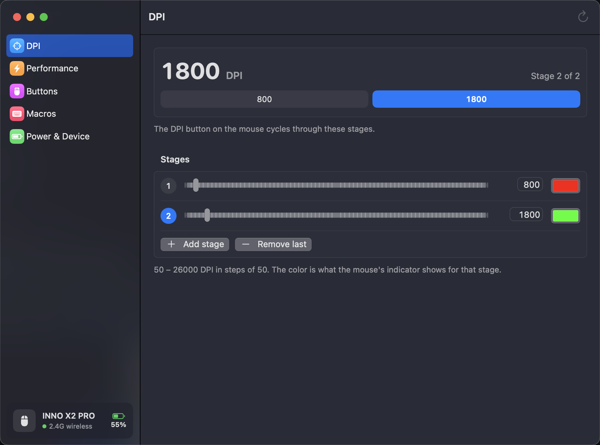
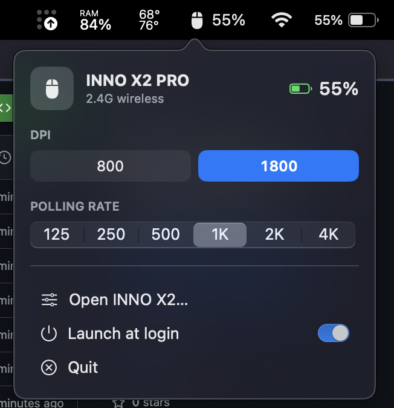

# INNO X2 for macOS

Unofficial macOS app for the **VortexSeries INNO X2 PRO** wireless mouse. Change DPI, polling rate, buttons and macros, and see the battery level in the menu bar, without the Windows-only driver.

The official web driver ([iotdriver.qmk.top](https://iotdriver.qmk.top)) only talks to the mouse through a local helper service that exists for Windows, so on a Mac it can't find the mouse. This app talks to the mouse's HID configuration channel directly.

<p>
  
  
</p>

## Download

Get the latest `.dmg` (or `.zip`) from [Releases](https://github.com/codewithwan/innox2-mac/releases). It runs on Apple Silicon and Intel Macs with macOS 15 or later.

1. Open the dmg and drag **INNO X2** into Applications.
2. The app is not notarized by Apple, so the first launch needs one extra step: right-click the app → **Open** → **Open**.
   If macOS says the app "is damaged", run this once in Terminal:
   ```sh
   xattr -cr "/Applications/INNO X2.app"
   ```
3. Plug in the 2.4G receiver (or the USB cable). The menu bar shows a mouse icon with the battery %.

No special permissions are needed; the app only uses the mouse's vendor HID interface.

## Features

- **Menu bar**: battery % next to the icon whenever the receiver or cable is plugged in.
  - Left-click opens a panel to switch DPI stage and polling rate, open the settings, toggle *Launch at login*, or quit.
  - Right-click opens a short menu.
- **DPI**: up to 8 stages (50 – 26000, steps of 50), the active stage, and the indicator color for each stage.
- **Performance**: polling rate 125 Hz – 4 kHz over 2.4G (8 kHz over USB cable), lift-off distance, angle snapping, ripple control and button debounce.
- **Buttons**: remap left, right, middle, both side buttons and the DPI button. Options are clicks, back/forward, scroll, DPI up/down/cycle, media keys, Mac shortcuts, a macro, or disabled.
- **Macros**: 20 slots stored on the mouse.
  - Record from the keyboard with real timing or a fixed delay, add mouse clicks, and edit each delay.
  - Bind a macro to any button as *run N times*, *toggle loop* or *while held*.
- **Power**: battery level, plus sleep timers for 2.4G and Bluetooth.
- **Device**: firmware version and factory reset.

Settings are written to the mouse itself, so they keep working on other computers and when the app isn't running.

Bluetooth mode can't be configured: over Bluetooth the mouse firmware doesn't accept settings from the computer, so use the receiver or the cable.

## Build from source

You need Xcode 16 or later (Swift 6 toolchain).

```sh
git clone https://github.com/codewithwan/innox2-mac.git
cd innox2-mac
./build.sh install     # builds INNO X2.app, copies it to /Applications and launches it
./build.sh package     # universal build, writes dist/*.dmg and dist/*.zip
```

`InnoX2 --dump` prints what the app reads from the mouse, which is useful for bug reports:

```sh
"/Applications/INNO X2.app/Contents/MacOS/InnoX2" --dump
```

## Protocol notes

The INNO X2 PRO is a ROYUAN-based mouse (USB vendor `0x3151`: receiver `0x402D`, cable `0x402A`, mouse id `0x05E2`).

- **Interface**: usage page `0xFFFF`, usage `2`, 64-byte feature report, report ID 0.
- **Packet**: byte `[0]` is the opcode, `[1..6]` are parameters, `[7] = 0xFF - sum([0..6])`, and `[8..63]` is data.
  A read uses the write opcode `| 0x80` and echoes the opcode in its reply; writes are not echoed.
- **Through the 2.4G receiver**, each command is relayed in this order:
  1. Poll `F7` until byte `[5] == 1`.
  2. Send `F6 05` to select the mouse.
  3. Send the command.
  4. Poll `F7` until byte `[0] == 1`.
  5. Send `FC`, then read the reply.

  `F7` also reports the battery in byte `[2]`, and the mouse is online when byte `[4] == 0`.

| Opcode (read / write) | What |
|---|---|
| `8F` | identify (`0x05E2`) |
| `80` | firmware version |
| `D3` / `53` | options: polling rate, debounce, flags, sleep timers, LOD, angle snap |
| `D4` / `54` | DPI table: active stage, 8 × u16 X/Y DPI, 8 RGB colors |
| `D0` / `50` | button map: 16 × 4-byte actions |
| `96` / `16` | macros: written in 56-byte pages, read back in 64-byte pages |
| `02` | factory reset |

[`Protocol.swift`](Sources/InnoX2/Protocol.swift) and [`Macro.swift`](Sources/InnoX2/Macro.swift) have the byte layouts. Other ROYUAN mice that use the same receiver family probably speak the same protocol, but only the INNO X2 PRO has been tested.

## Disclaimer

This is an independent project. It is not affiliated with or endorsed by VortexSeries or ROYUAN. It writes to the mouse's settings memory and never touches firmware or bootloader commands, but you use it at your own risk. If something goes wrong, **Power & Device → Factory reset** restores the defaults.

## License

[MIT](LICENSE)
